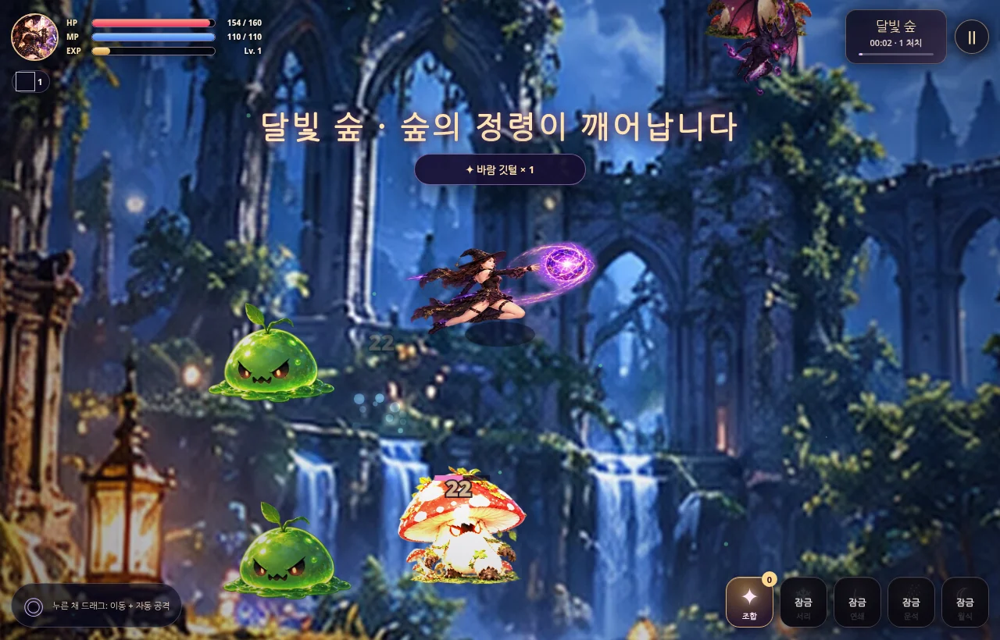

# v1.2 HQ Playable — 2026.10.31

## 개선 사항
- **스프라이트 분리 수정:** 생성 시트의 투명 영역과 실제 개체 경계 기준으로 잘라서 팔다리 혼입/잘림 현상을 개선. 대기·걷기·달리기·마법 시전 프레임을 재연결.
- **캐릭터/몬스터 화질:** 주인공 18프레임(350×430), 꼬마 마녀 28프레임(260×290), 8종 적(360×390)을 투명 WebP로 교체.
- **배경·아이템:** 4개 지역 배경(1800×1200), 16개 재료 아이콘(128×128), 고화질 타이틀 키아트.
- **액션·HUD:** 마법탄 이펙트, 콤보 점수, 보스까지 진행도 표시, 시전 포즈 최적화.
- **안정성:** 승리/패배 후 타이틀에 돌아갈 때 완료한 저장 데이터가 다시 생성되는 오류 수정. PWA 캐시 버전 변경.
- **미리보기:** 실제 Chromium 렌더링 캡처를 WebP로 수록(컨셉 이미지가 아님).

## 테스트 현황
- Chromium 내 HTML/CSS/JS 인메모리 구동: PC 1280×820, 모바일 390×844, 리소스 142/142 로드, 주요 메뉴·전투·연성·일시정지·재개: JavaScript 오류 없음.
- 현재 환경에서 HTTP/file URL 브라우저 이동은 정책상 차단되어 **실제 GitHub Pages 배포, 서비스 워커의 네트워크 설치·오프라인 동작, Android/iOS 실기기**는 검증하지 못했습니다. PWA 파일과 참조 무결성은 정적 검증했습니다.

# 마녀의 사냥 · Witch's Hunt

> 스마트폰 화면: [미리보기](assets/ui/preview_mobile.webp)

검은 마녀가 몬스터를 사냥하고 재료를 모아 고위 마법을 연성하는 **완전 정적 HTML/JS 아케이드 게임**입니다. 별도의 빌드 과정, CDN, 웹폰트, 백엔드, API 키는 필요하지 않습니다.

## 게임 방법

- **스마트폰:** 빈 게임 화면을 **누른 채 드래그**하면 조이스틱처럼 이동합니다. 누르는 동안 가까운 적을 향해 **마력탄이 자동 발사**됩니다. 손가락을 떼면 정지합니다.
- **PC:** 게임 화면에서 마우스 왼쪽 버튼을 **누르고 있으면** 포인터를 향해 이동하고 공격합니다. WASD / 방향키 이동, Space 공격, 1~4 마법, C 연성실, Esc 일시정지.
- 적을 처치하여 자동으로 떨어지는 재료를 가까이서 수집합니다. **조합** 버튼에서 재료를 사용해 서리 폭풍 → 연쇄 번개 → 붉은 운석 → 월식 대마법을 연성하세요. (어느 순서든 가능)
- 해금한 고위 마법은 자동 공격 중 적절한 거리에서 자동 시전되며 오른쪽 버튼으로 직접 발동할 수도 있습니다.
- 달빛 숲 → 잊힌 유적 → 서리 협곡 → 월식 제단에서 각 보스를 처치하면 승리합니다.
- 일시정지 → 설정에서 소리, 손을 떼도 자동 공격, 스프라이트 화풍을 조정할 수 있습니다.

## GitHub Pages 배포

1. ZIP 압축을 풀고 **압축을 푼 폴더 안의 파일 및 `assets/`, `icons/` 폴더 전체**를 저장소 **최상위**에 업로드합니다. (`index.html`이 저장소 루트에 있어야 편합니다.)
2. GitHub 저장소 **Settings → Pages → Build and deployment → Deploy from a branch**.
3. Branch `main`, folder `/(root)` 선택 → Save.
4. 서비스 주소 `https://사용자명.github.io/저장소명/` 에서 실행합니다. 모든 경로는 상대 경로라 저장소 서브 경로에서 작동합니다.
5. Android Chrome에서 '앱 설치', iPhone Safari에서 공유 → '홈 화면에 추가'로 설치 가능합니다.

> **주의:** `file://`에서 `index.html`을 직접 열면 게임 본체는 실행될 수 있지만 Service Worker / PWA 설치 / 오프라인 캐시는 작동하지 않습니다. PWA 검증은 HTTPS 또는 localhost에서 하세요.

## 로컬 실행

`python -m http.server 8080` 후 `http://localhost:8080`에 접속합니다. Python 3이 없다면 `npx`나 추가 패키지 설치 없이 Node.js `npx` 대신 `node` 내장 HTTP 모듈 서버를 사용할 수도 있습니다.

## 파일 구성

- `index.html` : 모바일 UI, HUD, 메뉴, 마법 조합/결과 창
- `style.css` : 반응형 고딕 마법 디자인
- `game.js` : Canvas 액션 엔진, 터치·마우스·키보드 입력, 적 AI, 보스, 마법, 저장
- `manifest.webmanifest`, `sw.js`, `icons/` : PWA 설치/오프라인 캐시
- `assets/hero/` : 걷기·달리기·캐스팅·공격·꼬마 마녀 스프라이트
- `assets/enemies/` : 8종 몬스터 스프라이트
- `assets/items/` : 16종 재료·보석 스프라이트
- `assets/vfx/` : 8종 마법 이펙트 × 8프레임
- `assets/backgrounds/` : 숲·유적·설원·월식 배경
- `assets/portraits/` : 원본 사진에 기반해 생성된 마녀 화보 5장(WebP)

### 기술/개인정보

- 온라인 통신 없이 오프라인으로 실행 가능(최초 온라인 로드로 캐시 후)
- 게임 진행/최고 점수/설정은 브라우저의 `localStorage`에만 저장합니다.
- 사용자 데이터 수집, 광고, 분석 SDK, 서버 전송 없음
- PWA manifest 호환을 위해 *앱 아이콘 2개만 PNG*이며 나머지 게임 리소스는 모두 WebP입니다.

### 알려진 범위

- Chrome 기반 데스크톱 및 스마트폰 터치 인터페이스를 목표로 구현했습니다. iOS Safari/실기기 성능은 환경에 따라 차이가 납니다.
- 원본 화보를 그대로 움직이는 실사 영상이 아니라, 화보를 바탕으로 생성된 **2D 스프라이트 아트**입니다.
